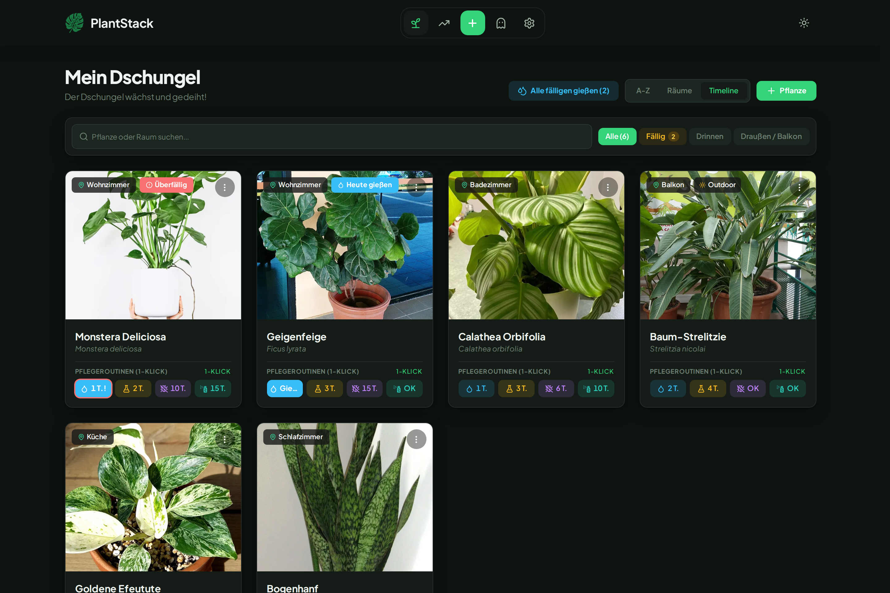
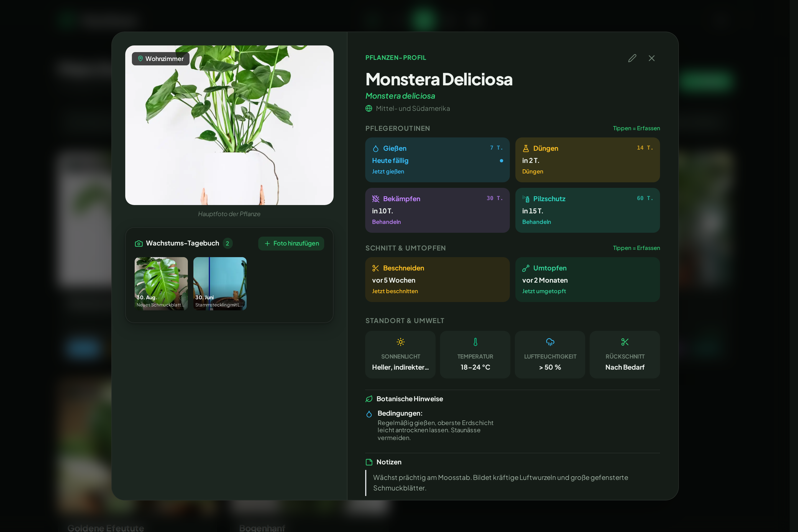
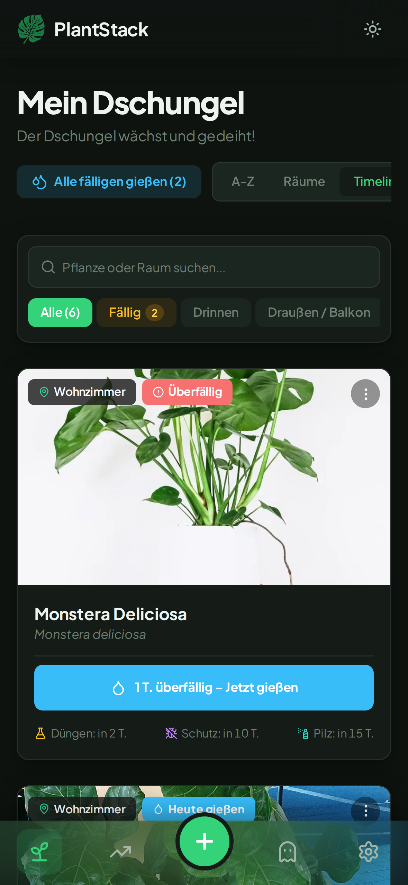
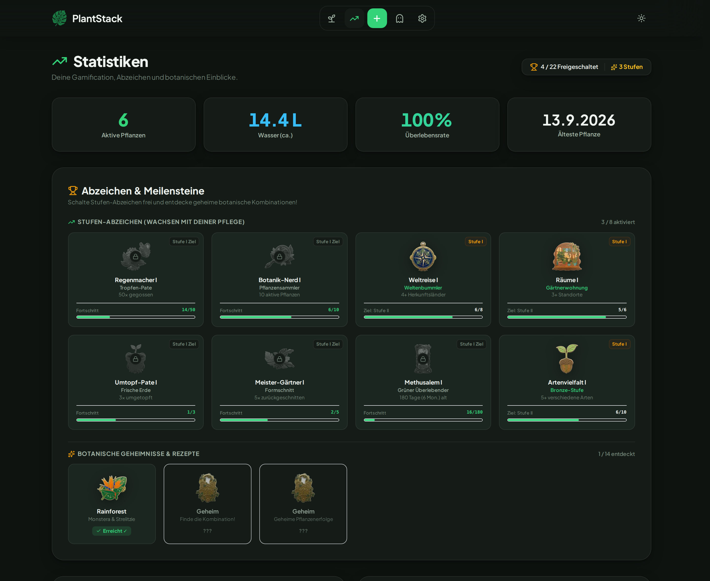
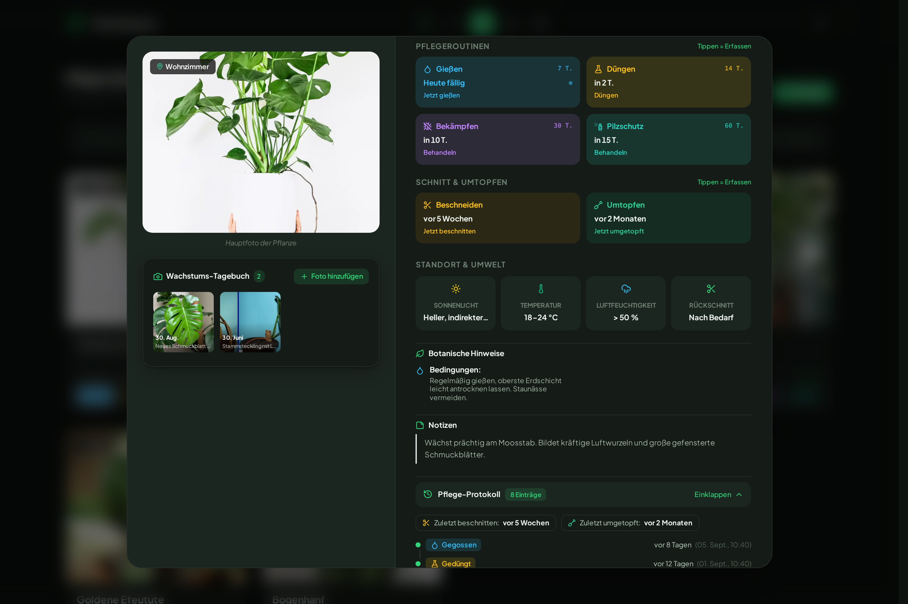

<p align="center">
  
</p>

<h1 align="center">PlantStack</h1>

<p align="center">
  <strong>A modern, minimalist, resource-efficient plant care management system for self-hosters.</strong><br>
  Built with Next.js 15, React 19, Tailwind CSS, Prisma & SQLite.
</p>

<p align="center">
  <a href="https://github.com/sm4sh-it/PlantStack/releases"></a>
  <a href="https://ghcr.io/sm4sh-it/plantstack"></a>
  
  
  
  <a href="LICENSE"></a>
</p>

---

## 🌿 Overview

**PlantStack** is a self-hosted web companion designed to keep your indoor jungle and balcony garden thriving without unnecessary complexity or cloud lock-in. It sorts your collection automatically by urgency, keeps track of routine and long-term care events, records photo timelines, and seamlessly integrates with your home automation.

---

## 📸 Screenshots & Showcase

<p align="center">
  
</p>

<details open>
  <summary><strong>🖼️ Click to expand preview gallery</strong></summary>
  <br>
  <table align="center" width="100%">
    <tr>
      <td width="50%" align="center">
        <strong>🌿 Botanical Studio & Care Modal</strong><br><br>
        
      </td>
      <td width="50%" align="center">
        <strong>📱 Mobile PWA & Ergonomic Dock</strong><br><br>
        
      </td>
    </tr>
    <tr>
      <td width="50%" align="center">
        <strong>📈 Vitality Curves & Gamification</strong><br><br>
        
      </td>
      <td width="50%" align="center">
        <strong>📷 Growth Diary & Care History</strong><br><br>
        
      </td>
    </tr>
  </table>
</details>

---

## ✨ Key Features

### 🎨 Botanical Modernism & Ergonomics
- **OLED-Optimized Dark & Light Modes:** Borderless, soft-tint visual hierarchy (*Anti-Outline Standard*) eliminating distracting white contours.
- **Progressive Web App (PWA):** Installable on iOS & Android with standalone fullscreen display and custom app icons.
- **5-Point Mobile Dock:** Seamless thumb-zone navigation between Dashboard, Statistics, Quick-Add `+`, Archive, and Settings.
- **One-Handed Care:** Enlarged 44px touch targets designed for comfortable operation directly at the flowerpot.
- **Configurable Grid & Compact List View:** Switch seamlessly between 1–6 column photo cards and a high-density list view with dynamic due care pills and `/` keyboard search.

### 🪴 Complete Care Tracking & Long-Term Retention
- **4-in-1 Routine Tracking:** Water 💧, Fertilizer ✨, Pest Combat 🐛, and Fungus Protection 🛡️.
- **1-Click Pruning & Repotting:** Dedicated actions for pruning (✂️) and repotting (🪴) with dual-storage architecture, ensuring long-term milestones are never displaced by frequent watering logs.
- **4-Tier Gentle Urgency:** Instant visual clarity (*Overdue*, *Due Today*, *Due Soon*, *In Schedule*).
- **Batch Watering:** Water all currently due plants with a single tap.
- **Snooze (+2 Days):** Postpone care when soil is still moist without falsifying historical care intervals.
- **Instant Undo:** Non-intrusive toast notifications to revert accidental taps immediately.

### 📷 Growth Photo Diary & Historical Logs
- **Multi-Photo Timeline:** Document leaf unfurlings, repottings, and seasonal growth with high-res photos, timestamps, and notes.
- **Collapsible Care History:** Transparent chronological event log tracking every historical action.

### 🌦️ Local Weather & Intelligent Winter Dormancy
- **Open-Meteo Weather Sync:** Automatically tracks precipitation, heat tiers, and issues outdoor frost warnings.
- **Winter Dormancy Mode:** Automatically extends watering intervals by 50% and safely pauses fertilizer from November to February to prevent overwatering and root rot.

### 🔍 Botanical Intelligence (Open Plantbook)
- **Zero-CLS Autocomplete:** Fast lookup for scientific names, natural origin, sunlight requirements, soil humidity, and watering intervals via [open.plantbook.io](https://open.plantbook.io).

### 📊 Analytics & Gamification
- **Vitality Curves & KPI Cards:** Total water estimates, active plant count, survival rate, and oldest plant.
- **Unlockable Badges:** Gamified achievement milestones with live teaser progress bars.

### 💾 1-Click Backup & Data Portability
- **Full ZIP Export/Import:** Download or restore your entire SQLite database and uploaded photo volume in one file directly from the Settings UI.

---

## 🚀 Quick Start (Docker Compose)

The fastest and most reliable way to run PlantStack on your home server or NAS (Synology, Unraid, TrueNAS, Raspberry Pi).

```yaml
services:
  plantstack:
    image: ghcr.io/sm4sh-it/plantstack:latest
    container_name: plantstack
    restart: unless-stopped
    ports:
      - "${PLANTSTACK_BIND_ADDR:-0.0.0.0}:9666:3000"
    volumes:
      - plantstack_data:/app/data
    environment:
      - NODE_ENV=production
      # Required declaration in .env/environment: set a strong secret, or "" explicitly for private Open LAN Mode
      - PLANTSTACK_API_SECRET=${PLANTSTACK_API_SECRET?Set PLANTSTACK_API_SECRET in .env or environment}
      # Optional: Dedicated read-only token for GET /api/plants/status
      # - PLANTSTACK_STATUS_TOKEN=your_readonly_status_token_here
      # Optional: Reverse proxy settings (only trust forwarded headers behind a proxy)
      # - PLANTSTACK_TRUST_PROXY=true
      # - PLANTSTACK_PUBLIC_ORIGIN=https://plants.example.com
      # Optional: Open Plantbook credentials for automated care data lookup
      # - OPENPLANTBOOK_CLIENT_ID=your_client_id_here
      # - OPENPLANTBOOK_CLIENT_SECRET=your_client_secret_here

volumes:
  plantstack_data:
```

Launch the stack:
```bash
docker compose up -d
```
Access the web dashboard at `http://<your-server-ip>:9666`.

---

## 🔒 Security & Self-Healing Architecture

### Access Control
- **Open LAN Mode (Explicit Opt-In):** Docker Compose requires `PLANTSTACK_API_SECRET` to be explicitly declared in `.env` (or environment) to avoid accidental open deployments. Setting `PLANTSTACK_API_SECRET=""` explicitly keeps zero-login access on your private home network; Docker binds `0.0.0.0:9666` by default via `${PLANTSTACK_BIND_ADDR:-0.0.0.0}:9666:3000`.
- **Reverse Proxy Lockdown:** If deploying behind Nginx, Caddy, or Traefik on the same machine, set `PLANTSTACK_BIND_ADDR=127.0.0.1` in `.env`. Configure `PLANTSTACK_TRUST_PROXY=true` and/or `PLANTSTACK_PUBLIC_ORIGIN=https://your-domain` when terminating TLS — `PLANTSTACK_TRUST_PROXY=true` also controls whether `X-Forwarded-For` / `X-Real-IP` headers are trusted for IP-based rate-limiting (ignored by default to prevent spoofing).
- **Protected Mode:** Set `PLANTSTACK_API_SECRET="your_strong_password"`. Visiting the UI displays an elegant botanical lockscreen and issues a signed, rotating 30-day session cookie (`v1.`, compatible with both plain local HTTP and reverse-proxy HTTPS). Protected media under `/api/images/*` also requires authentication. **Migration note:** Upgrading from older unsigned session cookies requires a one-time browser re-login.

### 🐳 Least-Privilege Runtime & SQLite Volume Self-Healing
Early Docker setups often suffer from `attempt to write a readonly database` when upgrading from older root-owned volumes (`0644`/`0755`).
- The startup entrypoint (`docker-entrypoint.sh`) operates with restrictive `umask 027`, repairs ownership/permissions solely on regular files and directories inside `/app/data` (`node:node`, `750`/`640`, never following symlinks or setting `777`), and then permanently drops root privileges via `su-exec node` before running Prisma or Node.js.
- **Pre-Migration DB Snapshots:** Before `prisma db push` runs on container start, `docker-entrypoint.sh` automatically saves a backup copy of `/app/data/database.db` under `/app/data/backups/` and retains the latest 3 snapshots.
- If an external container manager forces `--user 1000` over an existing root-owned host directory, the startup pre-check waits cleanly and prints least-privilege `chown 1000:1000` instructions instead of triggering a crash loop or granting `sudo`.

### Hardened Application Pipeline
- **Strict Media Validation & EXIF Stripping:** Uploads are checked against binary magic-byte signatures (JPEG, PNG, WebP) and size limits (10 MB per image), automatically orientation-corrected (`sharp` `.rotate()`), and re-encoded to WebP with all EXIF/GPS metadata stripped, alongside reference-safe orphan cleanup and unattached upload quotas.
- **Safe Archives:** Backup uploads support up to 150 MB (including plant photos) with pre-extraction central-directory checks, path-traversal protection, and zip-bomb thresholds.
- **Security Headers & CSRF:** Enforced modern HTTP headers and origin/fetch-site checks for mutating requests.

---

## 🤖 Vibe Coded with Gemini & Rigorously Audited

PlantStack is proudly **vibe-coded in pair-programming with Google Gemini (via the Antigravity CLI)** — embracing rapid iteration, modern React 19 / Next.js 15 paradigms, and high feature velocity.

However, rapid AI prototyping never comes at the expense of software quality or safety:
- 🛡️ **Comprehensive Security Audits:** Every major milestone undergoes structured security reviews (CWE audits covering OWASP Top 10 vulnerabilities).
- 🔒 **Defense-in-Depth:** Features strict binary magic-byte verification for image uploads, zip-bomb & path-traversal mitigation for backups, CSRF protection, and configurable single-secret access gates.
- 🐳 **Production-Grade Resilience:** Engineered with a self-healing container permission architecture specifically tested against real-world self-hosting environments (Synology NAS, Unraid, Portainer).

*Proof that modern AI pair-programming and solid engineering discipline make an unbeatable team.*

---

## 📡 Smart Home & Automation Integration

PlantStack provides an external status API designed for home automation widgets, MagicMirror modules, and ESPHome / e-ink bedside displays.

Send a `GET` request to:
```http
GET /api/plants/status
```

Returns a compact JSON list of all currently overdue plants, days overdue, and care recommendations. If Protected Mode (`PLANTSTACK_API_SECRET`) is enabled, authenticate via:
- **Recommended (read-only widget token `PLANTSTACK_STATUS_TOKEN`):**
  - Header: `Authorization: Bearer <PLANTSTACK_STATUS_TOKEN>` or `X-API-Key: <PLANTSTACK_STATUS_TOKEN>`
  - Query param (strictly scoped to `GET /api/plants/status` only): `?token=<PLANTSTACK_STATUS_TOKEN>`
- **Full API access (`PLANTSTACK_API_SECRET`):**
  - Header: `Authorization: Bearer <PLANTSTACK_API_SECRET>` or `X-API-Key: <PLANTSTACK_API_SECRET>`

> **Breaking Change Notice:** Passing the master `PLANTSTACK_API_SECRET` in `?token=` URL query parameters is no longer accepted. Existing Home Assistant or dashboard integrations using `?token=` must either switch to `Authorization: Bearer` / `X-API-Key` headers or set a dedicated read-only `PLANTSTACK_STATUS_TOKEN`.

---

## 🛠️ Local Development

```bash
# Clone repository
git clone https://github.com/sm4sh-it/PlantStack.git
cd PlantStack

# Install dependencies
npm install

# Push schema to local SQLite database
npx prisma db push

# Generate Prisma client
npx prisma generate

# Start dev server
npm run dev
```

---

## 📄 License

This project is licensed under the **PolyForm Noncommercial License 1.0.0** ([LICENSE](LICENSE)).  
It permits free use, modification, and sharing for personal and non-commercial purposes, ensuring PlantStack remains open for enthusiasts and self-hosters while preventing unauthorized commercial exploitation.
